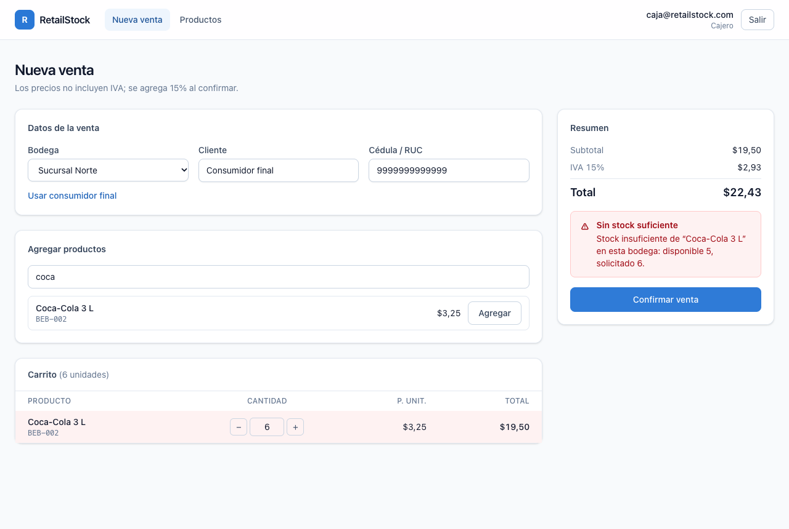
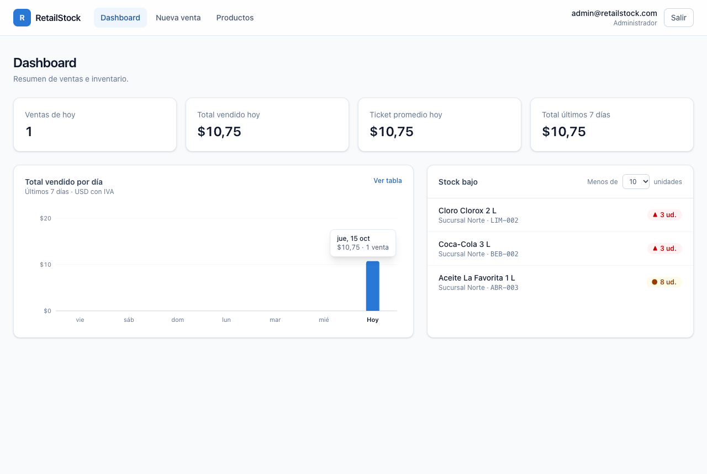
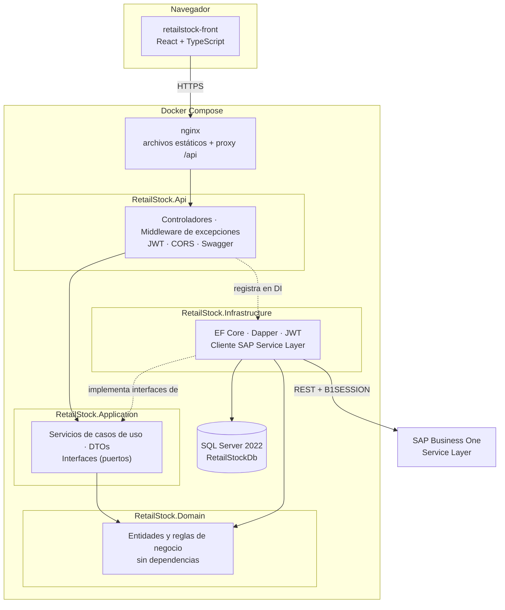
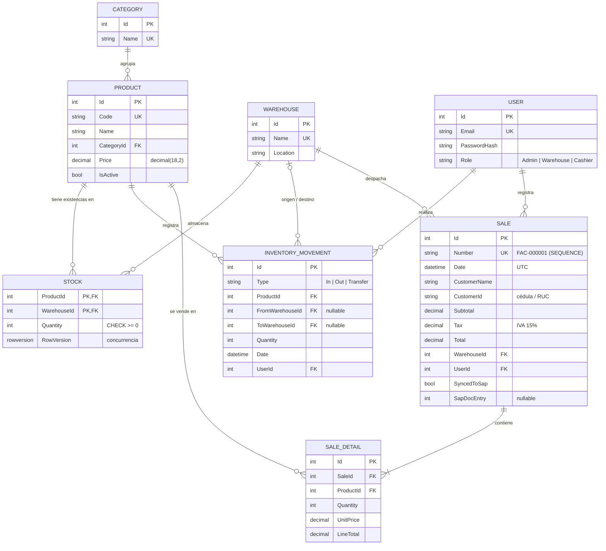

# RetailStock · Inventario y ventas

[](https://github.com/JavierYungaT/RetailStock/actions/workflows/ci.yml)

Sistema de **inventario y punto de venta** para un negocio retail (supermercado / comisariato mayorista).
Gestiona el catálogo, el stock por bodega, los movimientos de inventario y las ventas con IVA 15%,
ofrece reportes gerenciales sobre SQL Server y sincroniza las facturas con **SAP Business One**.

Backend en **ASP.NET Core 8** con arquitectura limpia, frontend en **React + TypeScript**, todo
orquestado con **Docker Compose** y validado en cada push con **GitHub Actions**.

| Nueva venta (stock insuficiente → 409) | Dashboard del administrador |
|---|---|
|  |  |

## Funcionalidades

- **Autenticación JWT** con roles `Admin`, `Warehouse` (bodega) y `Cashier` (caja); contraseñas con PBKDF2.
- **Catálogo**: productos, categorías y bodegas con paginación, búsqueda, validaciones y borrado lógico.
- **Inventario**: ingresos, egresos y transferencias entre bodegas con kardex de movimientos.
- **Ventas**: carrito, cálculo de subtotal / IVA 15% / total, numeración `FAC-000001` y descuento de stock
  en **una sola transacción**; concurrencia optimista (`rowversion`) para no vender dos veces la última unidad.
- **Reportes** con Dapper y procedimientos almacenados: ventas por día, stock bajo y productos más vendidos.
- **Integración con SAP B1 Service Layer**: cliente HTTP con sesión `B1SESSION`, reintentos (Polly),
  idempotencia por `NumAtCard`, mock para desarrollo y sincronización periódica en segundo plano.
- **Frontend** responsive: login, productos, nueva venta y dashboard con gráfico de ventas.

## Stack

| Capa | Tecnologías |
|---|---|
| API | .NET 8, ASP.NET Core Web API (controladores), Swagger/OpenAPI con Bearer |
| Datos | SQL Server 2022, EF Core 8 (CRUD, migraciones), Dapper (reportes, procedimientos almacenados) |
| Seguridad | JWT Bearer, roles, `PasswordHasher` (PBKDF2), user-secrets, CORS |
| Integración | `HttpClient` tipado, `Microsoft.Extensions.Http.Resilience` (Polly), `BackgroundService` |
| Pruebas | xUnit, Moq, FluentAssertions, EF Core InMemory, coverlet + ReportGenerator |
| Frontend | React 19, TypeScript, Vite, Tailwind CSS v4, React Router, axios |
| DevOps | Docker multi-stage (usuarios no root), Docker Compose, nginx, GitHub Actions |

## Arquitectura

Arquitectura limpia (puertos y adaptadores): las dependencias apuntan **hacia el dominio**.
Application define interfaces (repositorios, cliente SAP, generador de tokens) e Infrastructure las implementa.



| Proyecto | Responsabilidad | Depende de |
|---|---|---|
| `RetailStock.Domain` | Entidades, reglas (`Stock.Decrease`, cálculo de IVA en `Sale`), excepciones de negocio | — |
| `RetailStock.Application` | Casos de uso (`SaleService`, `InventoryService`, `SapSyncService`), DTOs, interfaces | Domain |
| `RetailStock.Infrastructure` | `AppDbContext`, repositorios EF y Dapper, JWT, cliente SAP y mock | Application, Domain |
| `RetailStock.Api` | Controladores, middleware ProblemDetails, autenticación, Swagger, `Program.cs` | Application, Infrastructure |
| `RetailStock.Tests` | Pruebas unitarias e integración ligera | Application, Domain, Infrastructure |

### Modelo de datos



## Ejecutar con Docker (recomendado)

Requisitos: **Docker Desktop**. En Mac con Apple Silicon activa *Settings → General → "Use Rosetta for x86_64/amd64
emulation"* (SQL Server solo publica imagen amd64).

```bash
git clone https://github.com/JavierYungaT/RetailStock.git
cd RetailStock
cp .env.example .env        # edita SA_PASSWORD y JWT_KEY (openssl rand -base64 48)
docker compose up -d --build
```

| Servicio | URL |
|---|---|
| Frontend | http://localhost:3000 |
| Swagger | http://localhost:5080/swagger |
| SQL Server | `localhost,1433` · usuario `sa` · contraseña de `.env` |

Al iniciar en `Development` la API **aplica las migraciones** (esquema, datos semilla y procedimientos
almacenados). El front se sirve con nginx, que también reenvía `/api` a la API (mismo origen, sin CORS).

```bash
docker compose logs -f api      # ver logs
docker compose down             # detener (conserva los datos)
docker compose down -v          # detener y BORRAR la base de datos
```

### Usuarios de prueba

| Rol | Email | Contraseña | Pantalla inicial |
|---|---|---|---|
| Admin | `admin@retailstock.com` | `Admin123!` | Dashboard |
| Cajero | `caja@retailstock.com` | `Cashier123!` | Nueva venta |
| Bodega | `bodega@retailstock.com` | `Warehouse123!` | Productos |

> Son credenciales de demostración creadas por el seed. En un entorno real se eliminan o se cambian.

## Desarrollo local (sin Docker para API y front)

```bash
# 1) Solo SQL Server en Docker
cp .env.example .env && docker compose up -d sqlserver

# 2) Secretos de la API fuera del repo (dotnet user-secrets, una sola vez)
dotnet user-secrets set "ConnectionStrings:DefaultConnection" \
  "Server=localhost,1433;Database=RetailStockDb;User Id=sa;Password=<SA_PASSWORD>;TrustServerCertificate=True;Encrypt=True" \
  --project src/RetailStock.Api
dotnet user-secrets set "Jwt:Key" "<JWT_KEY>" --project src/RetailStock.Api

# 3) API (aplica migraciones al arrancar) -> http://localhost:5080/swagger
dotnet run --project src/RetailStock.Api --launch-profile http

# 4) Front -> http://localhost:5173
cd retailstock-front && npm install && npm run dev
```

Migraciones con las herramientas locales (`dotnet tool restore`):

```bash
dotnet ef migrations add <Nombre> --project src/RetailStock.Infrastructure --startup-project src/RetailStock.Api --output-dir Persistence/Migrations
dotnet ef database update --project src/RetailStock.Infrastructure --startup-project src/RetailStock.Api
```

## Endpoints principales

Todos bajo `/api`. Errores en formato **ProblemDetails** (RFC 7807): 400 validación, 401 sin token,
403 sin rol, 404 no existe, 409 conflicto (duplicado, stock insuficiente), 502 error de SAP.

| Método | Ruta | Rol | Descripción |
|---|---|---|---|
| POST | `/auth/login` | público | Devuelve JWT, expiración y rol |
| POST | `/auth/register` | Admin | Crea un usuario con rol |
| GET | `/auth/me` | autenticado | Datos del usuario desde los claims |
| GET | `/products?page=&pageSize=&name=` | autenticado | Productos paginados con búsqueda |
| POST · PUT · DELETE | `/products[/{id}]` | Admin | Crear, editar, desactivar (borrado lógico) |
| GET · POST · PUT · DELETE | `/categories`, `/warehouses` | GET: autenticado · resto: Admin | CRUD de catálogo |
| POST | `/inventory/entries` · `/exits` · `/transfers` | Warehouse, Admin | Movimientos de inventario |
| GET | `/inventory/stock` · `/inventory/movements` | Warehouse, Admin | Existencias y kardex |
| POST | `/sales` | Cashier, Admin | Registra una venta (transacción) |
| GET | `/sales/{id}` · `/sales?from=&to=` | Cashier, Admin | Venta con detalle · listado por fechas |
| GET | `/reports/sales-by-day` · `/low-stock` · `/top-products` | Admin | Reportes (Dapper + procedimientos almacenados) |
| POST | `/sap/sync-sales` | Admin | Envía ventas pendientes a SAP como facturas |
| GET | `/health` · `/health/db` | público | Salud de la API y de SQL Server |

**Postman:** importa [`docs/postman/RetailStock.postman_collection.json`](docs/postman/RetailStock.postman_collection.json).
Variables `{{baseUrl}}` y `{{token}}`; cada login guarda el token automáticamente. También se ejecuta completa con
`npx newman run docs/postman/RetailStock.postman_collection.json`.

## Pruebas

```bash
dotnet test                                                     # 29 pruebas
dotnet test --settings tests/coverage.runsettings --results-directory TestResults
dotnet tool restore
dotnet reportgenerator -reports:"TestResults/*/coverage.cobertura.xml" -targetdir:coverage-report -reporttypes:Html
```

- **Dominio** (sin mocks): cálculo de IVA con redondeo comercial, reglas de stock.
- **Servicios** con Moq: venta válida, stock insuficiente sin guardar nada, producto inexistente, egresos.
- **Sincronización SAP** con EF InMemory + cliente SAP mockeado: una factura falla y las demás se sincronizan; idempotencia.

## Integración continua

[`.github/workflows/ci.yml`](.github/workflows/ci.yml) en cada push y pull request a `main`:
**backend** (restore, build Release, test con cobertura) · **frontend** (`npm ci`, lint, build) ·
**docker** (build de ambas imágenes con caché, si los anteriores pasan).

## Estructura del repositorio

```
RetailStock/
├── src/
│   ├── RetailStock.Domain/            entidades, enums, excepciones de negocio
│   ├── RetailStock.Application/       casos de uso por feature (Products, Sales, Inventory, Sap...)
│   ├── RetailStock.Infrastructure/    EF Core, migraciones, Dapper, JWT, cliente SAP
│   └── RetailStock.Api/               controladores, middleware, Program.cs, Dockerfile
├── tests/RetailStock.Tests/           xUnit + Moq + FluentAssertions
├── retailstock-front/                 React + Vite + Tailwind, Dockerfile + nginx.conf
├── database/scripts/                  demo de planes de ejecución (Index Seek vs Scan)
├── docs/                              colección Postman y capturas
├── docker-compose.yml · .env.example
└── .github/workflows/ci.yml
```

## Decisiones técnicas

- **EF Core para escribir, Dapper para leer reportes**: change tracking y transacciones donde hay reglas;
  SQL controlado y procedimientos almacenados donde importa el rendimiento (CQRS ligero).
- **Reglas en el dominio**: `Stock.Decrease` lanza `InsufficientStockException`; `Sale.AddDetail` recalcula
  IVA y total; las entidades tienen setters privados.
- **Venta atómica**: `BeginTransaction` dentro de la *execution strategy* de EF (compatible con reintentos);
  `rowversion` en `Stock` para concurrencia optimista; número de factura con `SEQUENCE` de SQL Server.
- **Índices diseñados para las consultas**: `IX_Sales_Date INCLUDE (Total)`, índice filtrado de ventas
  pendientes de SAP, rangos de fechas SARGables (ver `database/scripts/performance-demo.sql`).
- **Integración resiliente**: Polly solo reintenta métodos seguros (GET); los POST de facturas son
  idempotentes por `NumAtCard`; un fallo no detiene el lote.
- **Seguridad**: ningún secreto en el repositorio (`.env` y user-secrets), contenedores sin root,
  autorización por rol en la API (el front solo adapta la interfaz).
